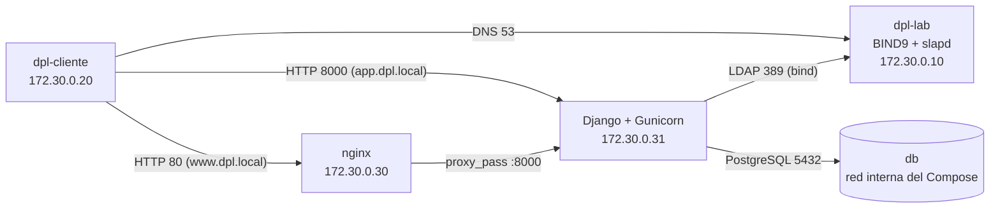

# AE6 - DNS y servicio de directorio para el despliegue

Autor: Abraham Diaz
Repositorio remoto: https://github.com/zeuspailoff/AE6
Repositorio de la aplicacion (AE4, con el override de la AE6): https://github.com/zeuspailoff/dpl-ae4

Entorno: Docker Desktop (WSL 2) sobre Windows. Contenedores `dpl-lab` y `dpl-cliente` con Ubuntu 24.04, BIND 9.18.39 y slapd/OpenLDAP, y la aplicacion de la AE4 (nginx + Django/Gunicorn).

## 1. Arquitectura



Red `dpl-net` (172.30.0.0/24) con IPs fijas para que la zona DNS no se invalide al reiniciar.

| Nombre | IP | Servicio |
|---|---|---|
| ns1.dpl.local | 172.30.0.10 | dpl-lab (BIND9 y slapd) |
| www.dpl.local | 172.30.0.30 | nginx |
| app.dpl.local | 172.30.0.31 | Django/Gunicorn |

## 2. Instalacion

```bash
docker network create --subnet 172.30.0.0/24 dpl-net
docker run -d --name dpl-lab --hostname dpl-lab --network dpl-net --ip 172.30.0.10 ubuntu:24.04 sleep infinity
docker run -d --name dpl-cliente --hostname dpl-cliente --network dpl-net --ip 172.30.0.20 --dns 172.30.0.10 ubuntu:24.04 sleep infinity

docker exec dpl-lab bash -c "apt-get update && DEBIAN_FRONTEND=noninteractive apt-get install -y bind9 bind9utils dnsutils iproute2 procps"
docker exec dpl-cliente bash -c "apt-get update && DEBIAN_FRONTEND=noninteractive apt-get install -y dnsutils iputils-ping ldap-utils curl"
```

`slapd` se instala con respuestas preconfiguradas (debconf) para que cree la base `dc=dpl,dc=local` sin asistente:

```bash
docker exec dpl-lab bash -c "echo 'slapd slapd/password1 password CAMBIAR_ESTO' | debconf-set-selections && echo 'slapd slapd/password2 password CAMBIAR_ESTO' | debconf-set-selections && echo 'slapd slapd/domain string dpl.local' | debconf-set-selections && echo 'slapd shared/organization string DPL' | debconf-set-selections && echo 'slapd slapd/no_configuration boolean false' | debconf-set-selections"
docker exec dpl-lab bash -c "DEBIAN_FRONTEND=noninteractive apt-get install -y slapd ldap-utils"
```

## 3. Arranque sin systemd

Los contenedores no tienen systemd, asi que los demonios se lanzan en primer plano con `docker exec -d` y se validan por proceso, puerto y configuracion:

```bash
docker exec dpl-lab bash -c "mkdir -p /run/named && chown bind:bind /run/named"
docker exec -d dpl-lab named -u bind -g
docker exec dpl-lab bash -c "mkdir -p /run/slapd && chown openldap:openldap /run/slapd"
docker exec -d dpl-lab slapd -d 0 -h "ldap:///" -u openldap -g openldap
```

El arranque automatico con systemd queda **no probado (sin systemd en contenedor)**.

## 4. DNS (BIND9)

Ficheros: `dns/named.conf.local` (declaracion de zona `type master`) y `dns/dpl.local.db` (zona). Se copian con `docker cp` a `/etc/bind/` y se validan con `named-checkconf` y `named-checkzone`.

- **SOA**: declara que este servidor es la autoridad de la zona. Su *serial* es lo que BIND compara para saber si la zona cambio: hay que subirlo en cada edicion (en el diagnostico quedo en 2026111603).
- **NS**: indica que servidor responde por la zona (`ns1.dpl.local`); necesita su propio registro A para poder localizarse.
- **A**: traduce un nombre a una IPv4. `app.dpl.local` necesita su registro A porque, sin el, ese nombre no existe para el DNS aunque el contenedor funcione.

## 5. Directorio (slapd)

`ldif/usuarios.ldif` crea `ou=usuarios` y los usuarios `alumno` y `maria` (clase `inetOrgPerson`; contrasena de laboratorio `CAMBIAR_ESTO`). Se carga con `ldapadd` y se comprueba con `slapcat`, `ldapsearch` y `ldapwhoami`.

## 6. Integracion de la aplicacion

La vista `/api/login` (ver `app/api/views.py` en el repositorio de la AE4) autentica contra el directorio asi:

1. Recibe `usuario` y `password`.
2. Construye el DN `uid=<usuario>,<LDAP_BASE_DN>` y hace un **bind** contra `LDAP_HOST` con la contrasena recibida. Si el servidor lo acepta responde 200; si no, 401.
3. Busca `cn` y `mail` con el filtro `LDAP_USER_FILTER` (por defecto `(uid=%s)`) y los devuelve como perfil.

Parametros (variables de entorno en `compose.ae6.yml`): `LDAP_HOST=ldap://172.30.0.10`, `LDAP_BASE_DN=ou=usuarios,dc=dpl,dc=local`, `LDAP_USER_FILTER=(uid=%s)`. El mismo fichero conecta `nginx` (172.30.0.30) y `app` (172.30.0.31) a `dpl-net`.

Nota de seguridad: `usuario` se inserta sin escapar en el DN y en el filtro (inyeccion LDAP posible). En un laboratorio aislado no afecta; en produccion habria que escapar esos valores.

## 7. Comprobaciones

- `comprobaciones.txt`: salidas reales generadas por la propia terminal (named, zona, dig, nslookup, host, ping, curl, ldapwhoami correcto e incorrecto, ldapsearch, slapcat y login 200/401).
- `scripts/comprobar.sh`: comprobacion automatica e idempotente; devuelve codigo distinto de cero si algo falla. Su ultima ejecucion: todas las comprobaciones OK, codigo de salida 0.

## 8. Problemas encontrados y solucion

| Problema | Causa | Solucion |
|---|---|---|
| `docker` no se reconocia en PowerShell | Docker Desktop no estaba instalado (la maquina virtual de Ubuntu no arrancaba) | Instalar Docker Desktop con winget |
| Docker Desktop: "Virtual Machine Platform is not enabled" | Faltaba la caracteristica de Windows para WSL 2 | `Enable-WindowsOptionalFeature ... VirtualMachinePlatform`, `wsl --install --no-distribution` y reiniciar |
| `dig @172.30.0.10` fallaba en PowerShell | `@` es el operador de splatting | Entrecomillar el argumento: `'@172.30.0.10'` |
| `nslookup` y `host` no encontrados en el cliente | `dnsutils` no estaba instalado | `apt-get install dnsutils` en `dpl-cliente` |
| VS Code no abria `dpl.local.db` | Asocia `.db` a un visor de bases de datos | Abrirlo con el editor de texto |
| `named-checkzone`: "file does not end with newline" | Faltaba el salto de linea final | Anadirlo y volver a copiar la zona |
| `docker compose` no encontraba `compose.ae6.yml` | El fichero se creo en la carpeta equivocada | Moverlo a `dpl-ae4` |
| `bash scripts/comprobar.sh` fallaba en PowerShell | `bash` resolvia al de WSL, sin distribucion instalada | Ejecutarlo con Git Bash |
| Rutas `/etc/bind/...` convertidas a rutas de Windows | Conversion automatica de rutas de Git Bash | `export MSYS_NO_PATHCONV=1` |

## 9. Informe de diagnostico

Detalle completo, con comandos y salidas reales, en [diagnostico.md](diagnostico.md). Cada fallo se provoco a proposito y sigue la estructura sintoma / causa / comprobacion / correccion / verificacion.

| # | Capa | Fallo provocado | Sintoma |
|---|---|---|---|
| 1 | DNS | Registro A de `www` apuntando a 172.30.0.99 | `www.dpl.local` resuelve a una IP sin servicio |
| 2 | Puerto | `proxy_pass` de nginx al puerto 8080 | 502 Bad Gateway, `Connection refused` en el log |
| 3 | Servidor Web | Errata `proxy_pas` en el server block | nginx no arranca (`Restarting`), puerto 80 cerrado |
| 4 | Servidor de aplicaciones | Contenedor de la aplicacion parado | La web no alcanza la aplicacion (timeouts y 502) y el login falla |
| 5 | Autenticacion | `LDAP_BASE_DN` erronea (`ou=personas`) | Login 401 con credenciales correctas y el directorio sano |

## 10. Control de versiones

Un commit por cambio (asunto y cuerpo), autoria con el nombre y correo del aula virtual. Historial: `git log --oneline`.
